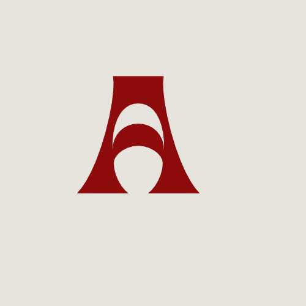

# Albanix OS

Albanian-first, fast, beautiful Arch Linux–based distribution with KDE Plasma 6.
Bootable live ISO (UEFI + BIOS) with the Calamares graphical installer, CachyOS-inspired
performance tuning, two complete system themes (Albanix Red / Albanix Blue), and full
Albanian localization (Shqip) plus English.



## Status

Pre-release. Phase 1–3 files are complete in this repository. Build your own ISO with
`./build.sh`, or wait for the first signed ISO attached to a GitHub release.

## What Albanix OS is

- **Arch Linux based** — `pacman`, `makepkg`, AUR compatibility, rolling release.
- **KDE Plasma 6** on Wayland by default (X11 fallback), SDDM, PipeWire/WirePlumber,
  NetworkManager, Bluetooth, CUPS, Flatpak + Flathub, Discover.
- **Two languages only**: Albanian (`sq_AL.UTF-8`, default) and English.
- **Two themes chosen at boot/install**: Albanix Red (black/red, Albanian flag motif)
  and Albanix Blue (navy/gold, Kosovo flag motif). Each theme covers Plasma, SDDM,
  Plymouth, bootloader, wallpaper, Konsole, fastfetch, starship, GTK/Qt accents.
- **CachyOS-inspired performance layer**: BORE-scheduler kernel option
  (`linux-cachyos-bore` fast path / self-built), CPU-tier optimized repos
  (`x86-64-v1/v3/v4`), sysctl tuning, zram+zstd, ananicy-cpp, Btrfs + Snapper
  snapshots, fstrim, systemd-oomd.
- **Secure by default**: ufw (deny incoming/allow outgoing), LUKS2 full-disk encryption
  option, AppArmor documented, no telemetry, no ads, no tracking. Nothing phones home
  except package mirrors and NTP.

## Repository layout (Phase 1 deliverable)

```
albanix-os/
├── archiso/                 # archiso live ISO profile (builds the bootable ISO)
│   └── profiles/albanix/
│       ├── profiledef.sh
│       ├── packages.x86_64  # package list, grouped and commented
│       ├── pacman.conf      # ISO + target pacman config
│       ├── customize_airootfs.sh
│       ├── build.sh
│       ├── airootfs/        # overlay copied into the live root
│       ├── efi/...          # UEFI systemd-boot entries (Red / Blue / safe graphics)
│       └── syslinux/        # BIOS boot menu
├── calamares/               # Calamares installer config (settings, branding, show.qml)
├── packages/                # Albanix PKGBUILDs (branding, keyring, welcome, tools, themes…)
├── scripts/                 # albanix-bench, albanix-theme, albanix CLI…
├── themes/                  # theme source (Plasma look-and-feel, Plymouth, SDDM, bootloader)
├── docs/                    # Markdown docs: install, keyboard, troubleshooting, theming, kernel
├── .github/workflows/       # CI: lint, build ISO, attach release assets, translation check
├── README.md                # this file (English)
├── README.sq.md             # Albanian version
├── LICENSE                  # GPL-3.0 (code); assets noted separately
├── CONTRIBUTING.md
├── CODE_OF_CONDUCT.md
├── SECURITY.md
├── CHANGELOG.md
└── ROADMAP.md
```

## Themes (preview)

| Theme | Palette | Motif | Default |
|-------|---------|-------|---------|
| Albanix Red | #E41E20 / #0B0B0F / gold #D4A537 | Albanian flag (red field, black double-headed eagle) | Yes |
| Albanix Blue | #244AA5 / #07101F / gold #D0A650 | Kosovo flag (blue field, gold map, six white stars) | No |

Choose in: (1) ISO boot menu, (2) Calamares step "Zgjidh temën / Choose your theme",
(3) `albanix-theme` CLI / settings tool after install. Default: Albanix Red.

## Quick start — build the ISO (HOST)

Requirements: Arch Linux host with `archiso`, `git`, `gnupg`, `squashfs-tools`, `xorriso`,
`dosfstools`, `devtools` (for clean-chroot builds).

```bash
# On the HOST
git clone https://github.com/YOURNAME/albanix-os.git
cd albanix-os
./build.sh
```

`build.sh` installs build dependencies, builds the Albanix packages in a clean chroot,
updates the local `[albanix]` repository, runs `mkarchiso`, and emits
`albanix-os.iso` plus `albanix-os.iso.sha256` and a detached GPG signature.

## Boot the ISO

- UEFI: systemd-boot menu — "Albanix OS (Red)", "Albanix OS (Blue)", "Albanix OS (safe graphics)".
- BIOS: syslinux menu with the same entries.
- Boot parameter `albanix.theme=red|blue` selects the live-session theme.
- Default language: Albanian (Shqip). Keyboard: Albanian (`al`) + US, Alt+Shift to switch.

## Install

Launch `calamares` from the live desktop (or the welcome app). The installer is
offline-capable: all packages needed for a base KDE system are on the ISO.

Installer steps: welcome → language (sq/en) → keyboard → timezone (Europe/Tirane default,
Europe/Belgrade for Kosovo) → partitioning (Btrfs @/@home/@snapshots…, optional LUKS2,
zram/swapfile) → user → theme choice → optional software groups → summary → install.

## Post-install

First login runs the welcome app "Mirë se vini në Albanix OS". Reopen it from the menu.
Use the `albanix` CLI:

```bash
# On the INSTALLED system (CHROOT-equivalent / normal user+sudo)
albanix update            # full system update with notifications
albanix theme red         # switch theme (red|blue)
albanix lang sq           # switch system language (sq|en)
albanix snapshot list     # Btrfs/Snapper snapshots
albanix bench             # boot/RAM/CPU/disk benchmark -> Markdown table
albanix info              # print system info for bug reports
```

## Security & trust model

- **Fast path**: install-time CPU detection optionally enables CachyOS optimized repos
  (`cachyos-v3` / `cachyos-v4`). That requires trusting the CachyOS signing key
  (`F3B607488DB35A47`) and their mirrors — clearly opt-in, generic x86-64 fallback by default.
- **Self-built path**: everything in this repo is built from source PKGBUILDs; no external
  trust required beyond Arch Linux itself and GPG-verified sources.
- Albanix packages are signed with the `[albanix]` repo key; install `albanix-keyring`
  from the ISO or GitHub Releases.

## No telemetry

Albanix OS does not phone home. The only network contacts are configured pacman mirrors,
NTP servers (Balkan/European pools + global fallback), and Flathub for Flatpak updates —
all user-configurable, all opt-outable.

## Credits

- Arch Linux and archiso (foundation)
- KDE Plasma 6, Calamares (installer framework)
- CachyOS (performance ideas: BORE kernel, optimized repos, sysctl/udev tuning) —
  inspiration only, no branding copied, license respected. See CREDITS in README.sq.md too.

## License

Code: GPL-3.0-or-later (`LICENSE`). Theme artwork and wallpapers: original Albanix OS
assets, SVGs drawn for this project — see `themes/` and `LICENSE` notes. KDE/Calamares/Arch
assets keep their upstream licenses.

---
Albanix OS — Shpejtë. E bukur. Shqiptare. / Fast. Beautiful. Albanian.