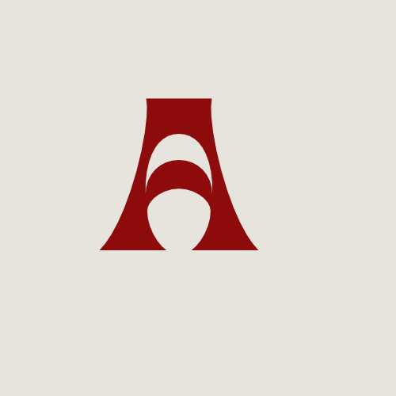

# Albanix OS

Distribucion Linux i parë shqip, i shpejtë i bukur, i bazuar në Arch Linux me KDE Plasma 6.
ISO live i bootuesh (UEFI + BIOS) me instalues grafik Calamares, parsimin e performancës
i inspiruar nga CachyOS, dy tema të plotë sisteme (Albanix Red / Albanix Blue) dhe
lokalizim të plotë shqip (Shqip) dhe angjlisht.



## Statusi

Para-publikim. Skedarat e fazës 1–3 janë të plotë në këtë repostitor. Ndërtoni ISO-vën
të veten me `./build.sh`, ose presni ISO-n e parë të signuar të ngarkuar si Release në GitHub.

## Çfarë është Albanix OS

- **I bazuar në Arch Linux** — `pacman`, `makepkg`, kompatibilitet me AUR, versionim rrotlloj.
- **KDE Plasma 6** me Wayland në fillim (X11 si paralias), SDDM, PipeWire/WirePlumber,
  NetworkManager, Bluetooth, CUPS, Flatpak + Flathub, Discover.
- **Dvetë gjuhë vetëm**: shqip (`sq_AL.UTF-8`, parazgjedhje) dhe angjisht.
- **Dy tema zgjedhin në fillim/during instalim**: Albanix Red (i zezë/i kuq, motivi i flamurit
  Shqiptar) dhe Albanix Blue (navy/gold, motivi i flamurit të Kosovës). Çdo temat mbrojtje
  Plasma, SDDM, Plymouth, bootloader, tapet, Konsole, fastfetch, starship, aksente GTK/Qt.
- **Parsimi i inspiruar nga CachyOS i performancës**: kernel me planifikues BORE
  (`linux-cachyos-bore` rast i shpejtë / self-built), repo optimizuar sipas CPU-së
  (`x86-64-v1/v3/v4`), sysctl tuning, zram+zstd, ananicy-cpp, Btrfs + Snapper snapshot,
  fstrim, systemd-oomd.
- **Sigurë në fillim**: ufw (refuzojnë hyrje/lejonin dalje), opsion i enkriptimit të diskit
  të plotë LUKS2, AppArmor dokumentuar, asnjë telemetri, reklama ose monitorizim. Asnjë
  kontakt pa qasje, përveç mirror-sve të paketave dhe NTP.

## Struktura e repostitorit (faza 1)

```
albanix-os/
├── archiso/                 # profili i archiso (ngrit ISO-n e bootuesh)
│   └── profiles/albanix/
│       ├── profiledef.sh
│       ├── packages.x86_64  # lista e paketave, e grupuar dhe me komente
│       ├── pacman.conf      # konfigurimi i pacman-it për ISO dhe sistem-in e instaluar
│       ├── customize_airootfs.sh
│       ├── build.sh
│       ├── airootfs/        # overlay i kopjuar në rrënzin e live
│       ├── efi/...          # hyrje UEFI systemd-boot (Red / Blue / safe graphics)
│       └── syslinux/        # menyja BIOS
├── calamares/               # konfigurim i instaluesit Calamares
├── packages/                # PKGBUILD-t e Albanix (branding, keyring, welcome, tools, tema…)
├── scripts/                 # albanix-bench, albanix-theme, CLI albanix…
├── themes/                  # burimi i temave (Plasma, Plymouth, SDDM, bootloader)
├── docs/                    # dokumentim Markdown: instalim, tastaturë, detajerror, tema, kernel
├── .github/workflows/       # CI: lint, ISO, Release, kontroll i përkthimeve
├── README.md                # kjo skedar (angjisht)
├── README.sq.md             # version shqip
├── LICENSE                  # GPL-3.0 (kod); asetët përshtatshëm
├── CONTRIBUTING.md
├── CODE_OF_CONDUCT.md
├── SECURITY.md
├── CHANGELOG.md
└── ROADMAP.md
```

## Temat (paraprakse)

| Tema | Paleta | Motifi | Parazgjedhje |
|------|--------|--------|--------------|
| Albanix Red | #E41E20 / #0B0B0F / art #D4A537 | Flamuri Shqiptar (fushë kuqe, shqiponja e dy-kokës e zezë) | Po |
| Albanix Blue | #244AA5 / #07101F / art #D0A650 | Flamuri i Kosovës (fushë e blu, harta e artë, nëntë yll të bardhë) | Jo |

Zgjidhni në: (1) menyn e boot-imit të ISO-së, (2) hapat e Calamares-it
"Zgjidh temën / Choose your theme", (3) `albanix-theme` CLI / aplikacion temash pas instalimit.
Parazgjedhja: Albanix Red.

## Fillim i shpejtë — ndërto ISO-n (HOST)

Kërkesat: makinë Arch Linux me `archiso`, `git`, `gnupg`, `squashfs-tools`, `xorriso`,
`dosfstools`, `devtools` (për ndërtimin në chroot të pastër).

```bash
# Në HOST
git clone https://github.com/YOURNAME/albanix-os.git
cd albanix-os
./build.sh
```

`build.sh` instalon varësitë e ndërrimit, ndërton paketat e Albanix në një chroot të
pastër, përditësoi repostitorin `[albanix]`, i menjëson `mkarchiso`, dhe delivron
`albanix-os.iso` bashkë me `albanix-os.iso.sha256` dhe signaturën GPK.

## Bootoni ISO-n

- UEFI: menyja systemd-boot — "Albanix OS (Red)", "Albanix OS (Blue)",
  "Albanix OS (safe graphics)".
- BIOS: syslinux me të njëjtën hyrje.
- Parametri `albanix.theme=red|blue` zgjedh temën e sesionit live.
- Gjuha parazgjedhje: Shqip (Shqip). Tastaturë: Shqiptare (`al`) + US, Alt+Shift për swap.

## Instaloni

Hani `calamares` nga desktop-i live (ose nga aplikacioni i mirëseardhjes). Instaluesi
është i aftë funksionojë pa internet: të gjithë paketat e nevojshme për sistemin bazë KDE
janë në ISO.

Hapat: mirëseardhja → gjuha (sq/en) → tastaturë → orësia (Europe/Tirane parazgjedhje,
Europe/Belgrade për Kosovën) → ndarja e disket (Btrfs @/@home/@snapshots…, LUKS2 opsional,
zram/swapfile) → përdoruesi → temë → grupat opcionale software → përmbledhja → instalim.

## Pas instalimit

Një hyrje të parë ekzekuton aplikacionin e mirëseardhjes "Mirë se vini në Albanix OS".
Hapni e rradhë nga menja. Përdorni komandën `albanix`:

```bash
# Në SISTEMIN E INSTALUAR (normal user + sudo)
albanix update            # përditësim i plotë i sistemit me njoftime
albanix theme red         # zhduk temën (red|blue)
albanix lang sq           # zhduk gjuhën e sistemit (sq|en)
albanix snapshot list     # snapshot-et Btrfs/Snapper
albanix bench             # provim boot/RAM/CPU/disk -> tabelë Markdown
albanix info              # printo informacione sisteme për raporte gabimesh
```

## Siguri dhe modeli i besimit

- **Rast i shpejtë (fast path)**: detektimi i CPU-së në instalim mund të sjellë repo-t
  optimizuar të CachyOS (`cachyos-v3` / `cachyos-v4`). Ky veç veç kërkon besim në çelësin
  e signimit të CachyOS (`F3B607488DB35A47`) dhe mirror-t e tyre — opsional, para-zgjedhja
  është x86-64 generic.
- **Rast i self-built**: çdo skedar në këtë repostitor ndërtohet nga PKGBUILD-t; asnjë
  besim i jashtëm përtej Arch Linux-it dhe burimeve të verifikuar me GPK.
- Paketat e Albanix janë të signuar me çelësin e repostitorit `[albanix]`; instaloni
  `albanix-keyring` nga ISO-sa ose GitHub Releases.

## Asnjë telemetri

Albanix OS nuk telefon në shtëji. Kontaktet e saj rrjeti janë configuarr mirror-t e
paketave, serverët NTP (bregdet Ballkan/Europë + parali global), dhe Flathub për përditësime
Flatpak — të gjithë konfigurueshëm, të gjithë mund ta humbasin.

## Kredituar

- Arch Linux dhe archiso (thelbës)
- KDE Plasma 6, Calamares (instaluesi)
- CachyOS (idee performancesi: kernel BORE, repo optimizuar, sysctl/udev tuning) —
  inspirim vetëm, asnjë brending kopjuar, licenca e respektohet. Shikoni CREDITS edhe në README.sq.md.

## Licenca

Kodi: GPL-3.0-or-later (`LICENSE`). Punimet e temës dhe tapetat: asetë origjinale Albanix OS,
SVG të vetmuar për këtë projekt — shikoni `themes/` dhe `LICENSE`. Asetet KDE/Calamares/Arch
ruan licencat e tyre të jashtëmshme.

---
Albanix OS — Shpejtë. E bukur. Shqiptare. / Fast. Beautiful. Albanian.